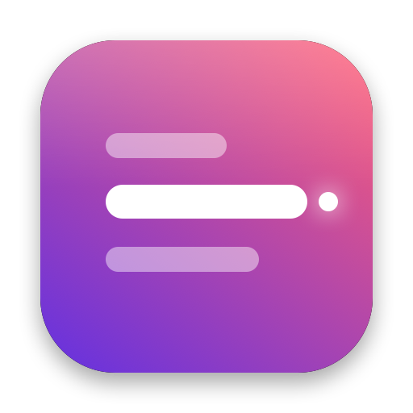

<div align="center">



# Lyrik

**Synced, word-by-word lyrics for Spotify and Apple Music, on your lock screen, your desktop or a shared screen.**


[Install](#-install) · [Run](#%EF%B8%8F-run-it) · [First launch](#-first-launch) · [Using Lyrik](#%EF%B8%8F-using-lyrik) · [Shortcuts](#%EF%B8%8F-presenter-shortcuts) · [Troubleshooting](#-troubleshooting)

</div>

---

## ✨ What it does

| | |
|---|---|
| 🎧 **Follows your player** | Detects Spotify or Apple Music automatically, reads the song, artwork and playhead, and controls play, pause, skip, seek and volume. |
| 📝 **Finds the lyrics** | Queries LRCLIB and NetEase in parallel, prefers word-level timing, and caches what it finds. |
| 🔒 **Lock screen overlay** | Lyrics sit above the macOS lock screen, clear of the clock, on each display you choose. |
| 🎨 **Ten styles** | Stack, Visual, Fisheye, Codestyle, Flashbang, Constellation, Branches, Wall, Messages and Notifications. |
| 📷 **Camera shake** | Every sung word kicks the camera. Switch it on or off, and pick Subtle, Punchy or Intense. |
| 🖥️ **Present Lyrics** | A full-bleed window you can share in Zoom, Meet or FaceTime, or put on a projector or AirPlay display. |

---

## 📋 Requirements

- A Mac with **Apple silicon** running **macOS 15 Sequoia or later**
- **Xcode 16 or later** (or its Command Line Tools) to build
- **Spotify** and/or **Apple Music** desktop app

Check the toolchain with:

```bash
swift --version
```

---

## 📦 Install

The install script builds Lyrik, copies it to `/Applications` (replacing any earlier copy), and opens it:

```bash
./scripts/install.sh
```

Prefer to do it by hand? Build, then copy:

```bash
./scripts/build.sh
```

```bash
ditto build/Lyrik.app /Applications/Lyrik.app
```

To uninstall, quit Lyrik from its menu bar icon and move `/Applications/Lyrik.app` to the Bin.

---

## ▶️ Run it

**From Applications:** open **Lyrik** from Spotlight, Launchpad or Finder. It is a menu bar app, so it has no
Dock icon. Look for the Lyrik icon at the top right of the screen.

**Without installing:** build, then open it straight from the build folder:

```bash
./scripts/build.sh
```

```bash
open build/Lyrik.app
```

**Open the main window directly:**

```bash
open /Applications/Lyrik.app --args --open-window
```

| Menu bar icon | What it does |
|---|---|
| **Left-click** | Opens the panel: now playing, controls, the current line, styles and quick toggles |
| **Right-click** | Menu: pinned styles, **Present Lyrics**, **Present Full Screen on…**, Open Lyrik, Show Log, Quit |

---

## 🚀 First launch

1. **Welcome:** the window walks you through setup.
2. **Allow access:** open Spotify or Music and choose **Allow** when macOS asks whether Lyrik may control it.
   macOS asks once per player, under *System Settings › Privacy & Security › Automation*.
3. **Pick a style:** hover over a card to preview it, then click it to use it.
4. **Play a song:** the lyrics appear in the preview, in the menu bar panel and on the lock screen.

---

## 🎛️ Using Lyrik

### The main window

- **Top bar:** artwork, song, transport controls, a seekable progress bar, player status dots and **Present**.
- **Preview stage:** the selected style running on the real song. The caption bar under it has the timing
  controls (*Earlier / On time / Later*) and the **Shake** toggle with its intensity menu.
- **Side panel tabs:**
  - **Styles:** pin favourites so they show in the menu bar.
  - **Look:** camera shake, edge glow, size, typeface, colours and backdrop.
  - **Lock:** lock screen overlay, keep awake, lyrics while unlocked, per-display switches.
  - **Players:** status and permission fixes for each player.

### Presenting lyrics on a shared screen

1. Click **Present** in the window or panel, or right-click the menu bar icon and choose
   **Present Full Screen on…** a display.
2. In a call, share the **Lyrik — Lyrics** window.
3. Move the mouse to show the toolbar; it fades away after a moment.

### ⌨️ Presenter shortcuts

| Key | Action |
|:---:|---|
| `Space` | Play / pause |
| `←` `→` | Previous / next track |
| `F` | Full screen |
| `S` or `1`–`0` | Next style / jump to a style |
| `[` `]` | Lyrics earlier / later by 0.5 s |
| `K` | Camera shake on / off |
| `C` | Album card |
| `G` | Edge glow |
| `Esc` | Leave full screen, or close |

---

## 🩺 Troubleshooting

<details>
<summary><b>Nothing shows as playing</b></summary>

Open the **Players** tab. If a player says *Blocked*, enable Lyrik under
*System Settings › Privacy & Security › Automation*, or click **Ask again**. Songs playing in a browser or on
another device are not visible to the desktop apps.
</details>

<details>
<summary><b>macOS asks for permission again after rebuilding</b></summary>

The app is ad-hoc signed, so macOS ties the Automation permission to each build. Allow it again once.
</details>

<details>
<summary><b>"No lyrics found"</b></summary>

Some songs have no synced lyrics on LRCLIB or NetEase. If the network was down, Lyrik keeps trying while the song
plays; you can also click **Look again**.
</details>

<details>
<summary><b>Lyrics are early or late</b></summary>

Use *Earlier / Later* in the caption bar, or `[` and `]` in the presenter. The shift is remembered per song.
</details>

<details>
<summary><b>Where is the log?</b></summary>

`~/Library/Logs/Lyrik.log`. You can also right-click the menu bar icon and choose **Show Log**.
</details>

---

## 🗂️ Project layout

```
Sources/Lyrik/
  App/       entry point, app delegate, settings, snapshot diagnostics
  Players/   Apple Events bridge, now-playing monitor, artwork palette
  Lyrics/    LRCLIB + NetEase providers, LRC/YRC parsers, lyric engine
  Styles/    the stage, camera shake and the ten styles
  Overlay/   lock screen and desktop windows
  System/    SkyLight space, lock monitor, keep-awake assertion
  UI/        main window, menu bar panel, presenter, onboarding, controls
Resources/   Info.plist, entitlements
scripts/     build.sh, install.sh, make-icon.swift (draws the icon in code)
docs/        design notes and images
```

## 🧪 For developers

- `Lyrik.app/Contents/MacOS/Lyrik --lyrics-test "<title>" "<artist>" <seconds>` prints what each lyric source returns.
- `Lyrik.app/Contents/MacOS/Lyrik --snapshot <dir>` renders the window, panel, presenter and every style to PNGs.
- The bundle identifier stays `local.cadence.lyrics`, from an earlier name, so existing settings and permissions carry over.

## ⚠️ Notes

- The lock screen layer uses private SkyLight calls. If a future macOS removes them, everything else keeps working
  and the Lock tab says the layer is unavailable.
- Lyrik is an independent app written from scratch. See [docs/VERCI-ANALYSIS.md](docs/VERCI-ANALYSIS.md) for the
  design notes it was built from.

---

<div align="center">

**Made by Abhimanyu**

</div>
